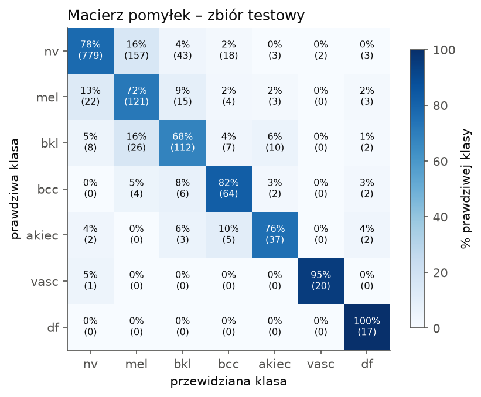
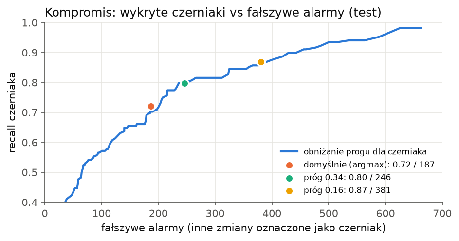
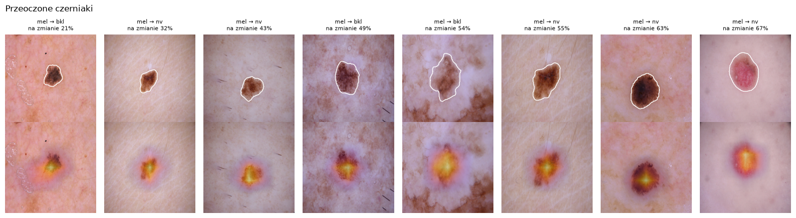

# Skin lesion classification with CNNs and Grad-CAM

Classification of 7 types of skin lesions on dermoscopic images (HAM10000), with a focus on **melanoma detection** and on checking **where the model looks** (Grad-CAM verified against lesion segmentation masks).

University project (AI course, MSc). Notebooks and reports are in Polish.

## Results

Final model: **EfficientNet-B0** (ImageNet transfer learning) + RandAugment + class-weighted cross-entropy, 30 epochs. Evaluated once on a held-out test set (1503 images, split by lesion).

| Metric | Test | 95% CI |
|---|---|---|
| Balanced accuracy | **0.815** | 0.785 – 0.842 |
| Melanoma recall | **0.720** | 0.654 – 0.789 |
| Melanoma recall, threshold 0.34 | **0.798** | – |
| Macro AUC | 0.961 | – |

A model that always predicts the majority class (nevus) gets 67% accuracy but 0.143 balanced accuracy, so balanced accuracy is the main metric.

Lowering the melanoma decision threshold to 0.34 (chosen on validation) raises melanoma recall from 72% to 80% on the test set without lowering balanced accuracy, at the cost of more false alarms.

<p align="center">
  
  
</p>

## Key findings

- **Data leakage.** HAM10000 often has several photos of the same lesion. With a random image-level split, 40% of test images (69% for melanoma) show lesions already seen in training, and balanced accuracy is inflated by ~7.6 pp. All experiments use a split grouped by `lesion_id`.
- **Transfer learning** beats a CNN trained from scratch by ~24 pp balanced accuracy (0.55 → 0.79).
- **Class imbalance handling** (weighted loss or oversampling) raises melanoma recall from 0.55 to 0.67–0.70. It shifts the decision boundary rather than improving class separation: the unweighted model has a similar AUC.
- **Augmentation:** RandAugment gives the best result. Without augmentation the model overfits after 3–5 epochs.
- **Grad-CAM:** the strongest point of the map lies on the lesion in **99.6%** of test images (lesion segmentation masks used as reference). The model does not rely on artifacts (rulers, hair, dark corners). Missed melanomas are looked at correctly but resemble benign nevi.



## Experiments

One factor changed at a time relative to E3. Each variant trained with 3 seeds; validation balanced accuracy (mean ± std):

| # | Model | Augmentation | Imbalance | Split | Bal. acc. |
|---|---|---|---|---|---|
| E1 | simple CNN (baseline) | basic | weighted CE | lesion | 0.551 ± 0.002 |
| E2 | ResNet50 | basic | weighted CE | lesion | 0.794 ± 0.005 |
| E3 | EfficientNet-B0 | basic | weighted CE | lesion | 0.786 ± 0.003 |
| E4 | EfficientNet-B0 | none | weighted CE | lesion | 0.777 ± 0.009 |
| **E5** | **EfficientNet-B0** | **RandAugment** | **weighted CE** | **lesion** | **0.799 ± 0.006** |
| E6 | EfficientNet-B0 | basic | plain CE | lesion | 0.730 ± 0.006 |
| E7 | EfficientNet-B0 | basic | oversampling | lesion | 0.778 ± 0.004 |
| E8 | EfficientNet-B0 | basic | weighted CE | random (leaky) | 0.862 ± 0.005 |

## Project structure

```
projekt-ham10000/
├── kamien1.ipynb        # data analysis, lesion-level split → data/splits.csv
├── kamien2.ipynb        # training and comparison of E1–E8 (GPU)
├── kamien3.ipynb        # test evaluation, error analysis, threshold, Grad-CAM + masks
├── model.py             # shared code: models, preprocessing, Grad-CAM
├── app.py               # Gradio app
├── data/                # metadata + split (images not in the repo)
├── out/                 # results.csv, history.csv, final checkpoint E5_s0.pt
├── figures/             # plots used in the reports
├── docs/                # milestone reports (PDF, Polish)
└── sprawozdanie_kamien*.md
```

## Setup

```bash
cd projekt-ham10000
python3.12 -m venv venv
source venv/bin/activate          # Windows: venv\Scripts\activate
pip install torch torchvision     # Windows + NVIDIA: use the CUDA command from pytorch.org
pip install -r requirements.txt
```

Data: download [HAM10000 from Kaggle](https://www.kaggle.com/datasets/kmader/skin-cancer-mnist-ham10000) or [Harvard Dataverse](https://doi.org/10.7910/DVN/DBW86T) and put `HAM10000_images_part_1/` and `HAM10000_images_part_2/` in `projekt-ham10000/data/`. The lesion segmentation masks used in `kamien3.ipynb` are downloaded automatically (11 MB).

## Usage

**App** (CPU is enough, uses the included checkpoint):

```bash
venv/bin/python app.py            # then open http://127.0.0.1:7860
```

Upload a dermoscopic image to get the top-3 lesion types with probabilities and a Grad-CAM map. The map can be shown for any class (e.g. "why not melanoma?").

**Notebooks:** run in order `kamien1` → `kamien2` (training, needs a GPU: 24 runs, ~2–3 h on an RTX 3060 Ti / 5080) → `kamien3` (CPU is fine, ~10 min). Training resumes from `out/results.csv`, so finished runs are skipped.

## Limitations

- Many false alarms: melanoma precision is 0.39 (about 1.5 false alarms per detected melanoma).
- Trained only on dermoscopic images from two centres, mostly light skin; results on phone photos or other populations may be wrong.
- Closed set of 7 classes: the model always picks one of them, even for images that are not skin lesions.
- Few test images for rare classes (df: 17, vasc: 21).

**This is an educational project, not a diagnostic tool.**

## Data source

Tschandl P., Rosendahl C., Kittler H. *The HAM10000 dataset, a large collection of multi-source dermatoscopic images of common pigmented skin lesions.* Scientific Data 5, 180161 (2018).

## Author

Michał Kowalik
