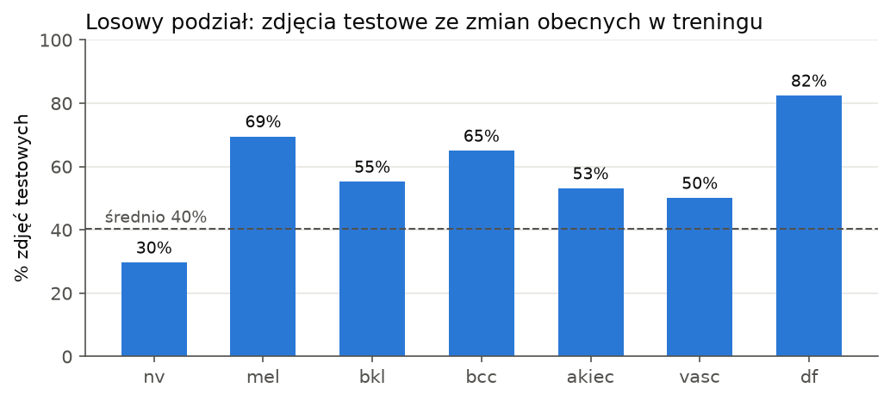

# Klasyfikacja zmian skórnych z wykorzystaniem CNN, ze szczególnym uwzględnieniem wykrywania czerniaka

*Sprawozdanie – kamień milowy 1 · Michal Kowalik · listopad 2026*

## 1. Cel projektu

Celem projektu jest klasyfikacja zdjęć dermatoskopowych do 7 typów zmian skórnych z użyciem sieci konwolucyjnych, ze szczególnym naciskiem na wykrywanie czerniaka. Dodatkowo metodą Grad-CAM sprawdzone zostanie, czy model opiera decyzję na samej zmianie, czy na artefaktach (linijki, włosy, ramki).

**Pytanie badawcze:** czy CNN rozpozna typ zmiany, a zwłaszcza czerniaka, na zdjęciu zmiany, której nie widziała podczas uczenia?

**Weryfikacja:** porównanie wariantów z baseline'em na podziale bez wycieku danych, metryki odporne na niezbalansowanie, ocena końcowa jednokrotnie na zbiorze testowym.

## 2. Zbiór danych i jego analiza

Zbiór **HAM10000**: 10 015 zdjęć dermatoskopowych, 7 klas, etykiety potwierdzone przez ekspertów (wszystkie czerniaki – histopatologicznie). Standardowy benchmark (ISIC 2018), dostępny publicznie:
https://www.kaggle.com/datasets/kmader/skin-cancer-mnist-ham10000

| Klasa           | Opis                    | Zdjęcia         | Zmiany          | Train           | Val             | Test            |
| --------------- | ----------------------- | ---------------- | --------------- | --------------- | --------------- | --------------- |
| nv              | znamię barwnikowe      | 6 705            | 5 403           | 4 694           | 1 006           | 1 005           |
| mel             | **czerniak**      | 1 113            | 614             | 779             | 166             | 168             |
| bkl             | łagodne rogowacenie    | 1 099            | 727             | 769             | 165             | 165             |
| bcc             | rak podstawnokomórkowy | 514              | 327             | 359             | 77              | 78              |
| akiec           | rogowacenie słoneczne  | 327              | 228             | 228             | 50              | 49              |
| vasc            | zmiany naczyniowe       | 142              | 98              | 100             | 21              | 21              |
| df              | włókniak skóry       | 115              | 73              | 80              | 18              | 17              |
| **razem** |                         | **10 015** | **7 470** | **7 009** | **1 503** | **1 503** |

Najważniejsze obserwacje:

- **Silne niezbalansowanie** – nv to 67% zdjęć, df tylko 1,1% (58 : 1). Model zawsze wskazujący nv miałby 67% accuracy i 0% wykrytych czerniaków, dlatego główną metryką jest balanced accuracy.
- **Wiele zdjęć jednej zmiany** – 10 015 zdjęć to tylko 7 470 zmian; 45% zdjęć ma „bliźniaka”. Najwięcej dotyczy to czerniaka (1,81 zdjęcia na zmianę).
- **Źródło zdjęć powiązane z klasą** – np. 90% akiec pochodzi z jednego ośrodka. Model może uczyć się cech aparatu zamiast zmiany, co zostanie sprawdzone Grad-CAM-em.

## 3. Przygotowanie danych

Podział 70 / 15 / 15 wykonano `StratifiedGroupKFold` (scikit-learn): **wszystkie zdjęcia jednej zmiany trafiają do tego samego zbioru** (grupowanie po `lesion_id`), a proporcje klas są zachowane (tabela wyżej). Wynik zapisano w `data/splits.csv`. Zbiór testowy zostanie użyty tylko raz, w kamieniu 3.

Dla porównania sprawdzono zwykły losowy podział po zdjęciach:

Przy losowym podziale **40% zdjęć testowych** (dla czerniaka **69%**) to zmiany obecne w treningu – wyniki byłyby zawyżone przez zapamiętanie konkretnych zmian. Przy podziale po `lesion_id` wyciek wynosi 0%.

## 4. Plan eksperymentów

**Metryki:** balanced accuracy (główna), macro-F1, recall czerniaka, AUC. Każdy wariant 3 razy (różne ziarna losowe), wynik jako średnia ± odchylenie.

**Baseline:** prosta CNN (4 bloki konwolucyjne) uczona od zera. **Referencja:** EfficientNet-B0 (transfer learning z ImageNet). W każdym eksperymencie zmieniany jest jeden czynnik względem E3.

| #  | Model           | Augmentacja | Niezbalansowanie | Podział  | Sprawdza   |
| -- | --------------- | ----------- | ---------------- | --------- | ---------- |
| E1 | prosta CNN      | podstawowa  | ważona CE       | lesion_id | baseline   |
| E2 | ResNet50        | podstawowa  | ważona CE       | lesion_id | H1         |
| E3 | EfficientNet-B0 | podstawowa  | ważona CE       | lesion_id | referencja |
| E4 | EfficientNet-B0 | brak        | ważona CE       | lesion_id | H3         |
| E5 | EfficientNet-B0 | RandAugment | ważona CE       | lesion_id | H3         |
| E6 | EfficientNet-B0 | podstawowa  | zwykła CE       | lesion_id | H2         |
| E7 | EfficientNet-B0 | podstawowa  | oversampling     | lesion_id | H2         |
| E8 | EfficientNet-B0 | podstawowa  | ważona CE       | losowy    | H4         |

**Hipotezy:**

- **H1:** transfer learning daje lepsze wyniki niż CNN uczona od zera.
- **H2:** ważona strata lub oversampling zwiększają recall czerniaka.
- **H3:** augmentacja poprawia wyniki, szczególnie dla rzadkich klas.
- **H4:** losowy podział zawyża wyniki względem podziału po `lesion_id`.
- **H5:** część błędów wynika z patrzenia modelu poza zmianę (Grad-CAM, kamień 3).

Najlepszy model zostanie wybrany według balanced accuracy na zbiorze walidacyjnym, a w kamieniu 3 oceniony na zbiorze testowym, przeanalizowany Grad-CAM-em i osadzony w prostej aplikacji (wgranie zdjęcia → klasa + mapa Grad-CAM).

**Ograniczenia:** mało przykładów klas df i vasc, zdjęcia z dwóch ośrodków (głównie jasna karnacja), model uczony wyłącznie na zdjęciach dermatoskopowych – nie jest narzędziem diagnostycznym.
