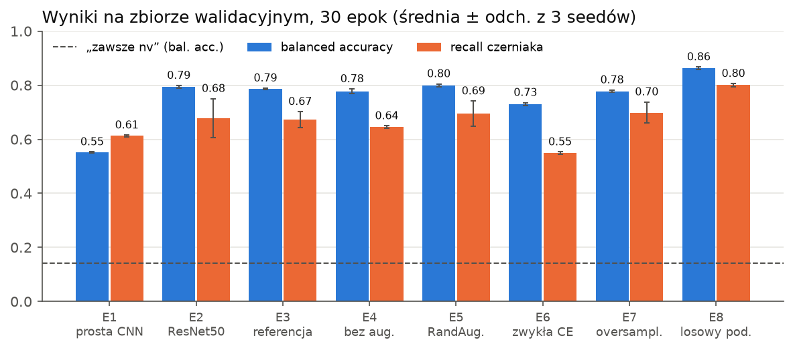
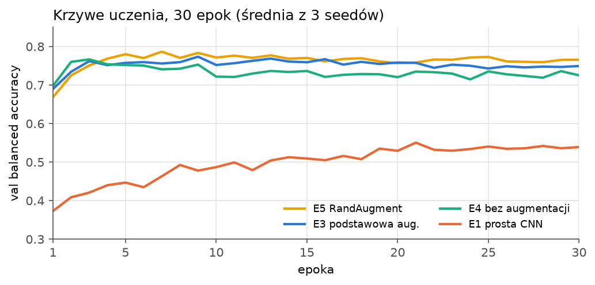

# Klasyfikacja zmian skórnych z wykorzystaniem CNN, ze szczególnym uwzględnieniem wykrywania czerniaka

*Sprawozdanie – kamień milowy 2 · Michał Kowalik · listopad 2026*

## 1. Cel etapu

Celem etapu była implementacja i przeprowadzenie eksperymentów E1–E8 zaplanowanych w kamieniu 1, weryfikacja hipotez H1–H4 oraz wybór najlepszego wariantu modelu. Wszystkie wyniki podane są na zbiorze walidacyjnym. Zbiór testowy nie był używany i posłużył do oceny końcowej w kamieniu 3.

## 2. Implementacja

| Element | Rozwiązanie |
|---|---|
| Dane | podział z kamienia 1 (`splits.csv`, po `lesion_id`); obrazy 256 × 256, wejście sieci 224 × 224 |
| Modele | prosta CNN (4 bloki conv–BN–ReLU–pool, 0,4 mln parametrów), ResNet50 (23,5 mln), EfficientNet-B0 (4,0 mln); sieci wstępnie wytrenowane na ImageNet z ostatnią warstwą wymienioną na 7 klas |
| Augmentacja | brak / podstawowa (losowe kadrowanie, odbicia, obrót ±20°, jasność i kontrast) / RandAugment |
| Niezbalansowanie | zwykła CE / ważona CE (waga klasy = liczba zdjęć / (7 · liczność klasy)) / oversampling (`WeightedRandomSampler`) |
| Trening | AdamW (lr 1e-4, dla CNN od zera 1e-3), harmonogram cosinusowy, 30 epok (pierwotnie 15 – sekcja 6), batch 32, mixed precision |
| Wybór epoki | zapis modelu z najwyższym balanced accuracy na walidacji |
| Powtórzenia | 3 ziarna losowe na wariant, łącznie 24 treningi |
| Sprzęt | 15 epok: RTX 3060 Ti (2 h 10 min); 30 epok: RTX 5080 (2 h 50 min) |

Kod znajduje się w notebooku `kamien2.ipynb`.

## 3. Wyniki (30 epok)

| # | Wariant | Balanced acc. | Macro-F1 | Recall mel | AUC |
|---|---|---|---|---|---|
| E1 | prosta CNN (baseline) | 0,551 ± 0,002 | 0,444 | 0,612 | 0,883 |
| E2 | ResNet50 | 0,794 ± 0,005 | 0,718 | 0,679 | 0,964 |
| E3 | EfficientNet-B0 (referencja) | 0,786 ± 0,003 | 0,724 | 0,673 | 0,962 |
| E4 | bez augmentacji | 0,777 ± 0,009 | 0,715 | 0,645 | 0,954 |
| E5 | **RandAugment** | **0,799 ± 0,006** | 0,726 | 0,695 | 0,965 |
| E6 | zwykła CE | 0,730 ± 0,006 | 0,739 | 0,548 | 0,967 |
| E7 | oversampling | 0,778 ± 0,004 | 0,725 | 0,699 | 0,963 |
| E8 | podział losowy (wyciek) | 0,862 ± 0,005 | 0,816 | 0,800 | 0,978 |

Punkt odniesienia – model zawsze wskazujący nv – osiąga balanced accuracy 0,143.

## 4. Weryfikacja hipotez

**H1 – transfer learning > CNN od zera: potwierdzona.** Sieci wstępnie wytrenowane osiągają ok. 24 punkty procentowe wyższe balanced accuracy (0,551 → 0,79). ResNet50 wypadł minimalnie lepiej od EfficientNet-B0 (0,794 vs 0,786 – różnica bliska rozrzutowi między seedami) przy podobnym recallu czerniaka (0,68 vs 0,67), jednak EfficientNet ma 6 razy mniej parametrów i trenuje się szybciej. Krzywa uczenia prostej CNN wypłaszcza się dopiero ok. 20.–25. epoki – sieć uczona od zera potrzebuje znacznie dłuższego treningu.

**H2 – obsługa niezbalansowania zwiększa recall czerniaka: potwierdzona.** Recall czerniaka rośnie z 0,548 (zwykła CE) do 0,673 (ważona CE) i 0,699 (oversampling). Model ze zwykłą CE ma przy tym najwyższe AUC spośród wariantów z poprawnym podziałem (0,967), ale wyraźnie faworyzuje nv (recall nv 0,94 wobec 0,84 w E3). Ważenie i oversampling nie poprawiają więc samej zdolności rozróżniania klas, tylko przesuwają granicę decyzji w stronę klas rzadkich. Obie metody dają zbliżone wyniki.

**H3 – augmentacja poprawia wyniki: potwierdzona częściowo.** RandAugment dał najlepszy wynik (0,799), wyższy od E3 w każdym z trzech seedów. Podstawowa augmentacja daje niewielką poprawę względem jej braku (0,786 vs 0,777), a krzywe uczenia pokazują, że bez augmentacji model przeucza się – najlepszy wynik osiąga w 3.–5. epoce, po czym balanced accuracy spada do ok. 0,72. Szczególnej poprawy dla klas rzadkich nie zaobserwowano – zbiór walidacyjny zawiera zbyt mało ich zdjęć (np. 18 zdjęć df), by różnice per klasa były wiarygodne.

**H4 – losowy podział zawyża wyniki: potwierdzona.** Przy losowym podziale balanced accuracy wzrasta o 7,6 punktu procentowego (0,862 vs 0,786), a recall czerniaka o 13 punktów (0,800 vs 0,673). Recall klas df i vasc dochodzi do 0,94–0,97, co zgadza się z największym wyciekiem zmierzonym dla tych klas w kamieniu 1. Wynik potwierdza konieczność podziału po `lesion_id`.

## 5. Wybór modelu

Wariant: **E5 – EfficientNet-B0 + RandAugment + ważona CE**, czyli najwyższe średnie balanced accuracy spośród wariantów z poprawnym podziałem (E8 pominięto). Spośród trzech seedów E5 najwyższe balanced accuracy ma s2 (0,807), ale ma niższy recall czerniaka (0,675). Ponieważ celem projektu jest wykrywanie czerniaka, wybrano ziarno o najwyższym recallu czerniaka – **E5_s0** (balanced accuracy 0,798, recall czerniaka 0,759).

Sprawdzono też, czy lepsze byłoby ziarno s2 z obniżonym progiem decyzyjnym dla czerniaka: przy tym samym recallu czerniaka (0,76) daje ono 199 fałszywych alarmów wobec 178 dla E5_s0, więc wybór E5_s0 jest korzystny także po uwzględnieniu progu. Recall czerniaka wyraźnie różni się między ziarnami (0,65–0,76), dlatego wynik na zbiorze testowym mógł być nieco niższy (w kamieniu 3 wyniósł 0,72).

## 6. Wpływ długości treningu: 15 vs 30 epok

Pierwotnie modele trenowano 15 epok. Ponieważ najlepsze epoki E1 i E5 wypadały pod koniec treningu, na sugestię prowadzącego powtórzono pełny zestaw eksperymentów E1–E8 (3 ziarna, 24 treningi) przy 30 epokach. Pozostałe ustawienia bez zmian.

| Wariant | Balanced acc. 15 → 30 | Recall mel 15 → 30 |
|---|---|---|
| E1 prosta CNN | 0,526 → 0,551 (+0,025) | 0,584 → 0,612 (+0,028) |
| E2 ResNet50 | 0,783 → 0,794 (+0,011) | 0,608 → 0,679 (+0,070) |
| E3 EfficientNet-B0 | 0,779 → 0,786 (+0,008) | 0,671 → 0,673 |
| E4 bez augmentacji | 0,775 → 0,777 | 0,649 → 0,645 |
| E5 RandAugment | 0,797 → 0,799 | 0,691 → 0,695 |
| E6 zwykła CE | 0,714 → 0,730 (+0,016) | 0,526 → 0,548 |
| E7 oversampling | 0,780 → 0,778 | 0,699 → 0,699 |
| E8 podział losowy | 0,856 → 0,862 | 0,770 → 0,800 (+0,030) |

Wydłużenie treningu do 30 epok daje poprawę marginalną, w dużej części mieszczącą się w rozrzucie między ziarnami. Balanced accuracy rośnie nieznacznie niemal wszędzie (najwięcej baseline E1: +0,025 i E6: +0,016), żadna metryka istotnie nie spada. Najwyraźniejszy zysk to recall czerniaka w E2 (+0,070) i przy losowym podziale E8 (+0,030). Ranking wariantów oraz wnioski H1–H4 pozostają bez zmian, co potwierdza, że przy 15 epokach modele były już blisko wysycenia.

Dla wybranego modelu E5_s0 dłuższy trening zmienił profil błędów (zbiór walidacyjny):

| Metryka | 15 epok | 30 epok |
|---|---|---|
| balanced accuracy | 0,815 | 0,798 |
| macro-F1 | 0,746 | 0,711 |
| recall czerniaka | 0,705 | **0,759** (+0,054) |
| AUC czerniaka | 0,914 | 0,899 |

Dłuższy trening podniósł recall czerniaka o ok. 5 punktów procentowych kosztem ok. 2 punktów balanced accuracy. To korzystny kompromis dla zastosowania przesiewowego, w którym przeoczony czerniak jest groźniejszy niż fałszywy alarm.

## 7. Ograniczenia

- Metryki dla klas rzadkich są niestabilne ze względu na małą liczbę zdjęć w walidacji (df: 18, vasc: 21).
- Recall czerniaka silnie zależy od ziarna losowego (0,65–0,76 dla E5), więc wybór seeda jest częściowo kwestią przypadku.
- Recall czerniaka ok. 0,76 oznacza, że model pomija ok. 1 na 4 czerniaki; dobór progu decyzyjnego przeanalizowano w kamieniu 3.
