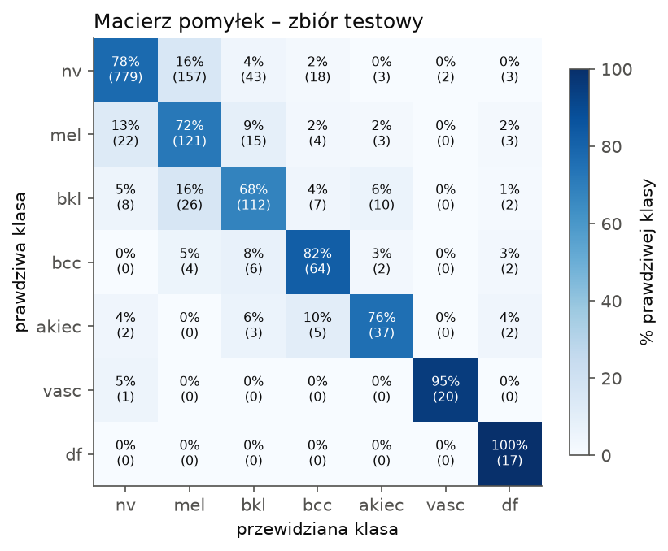
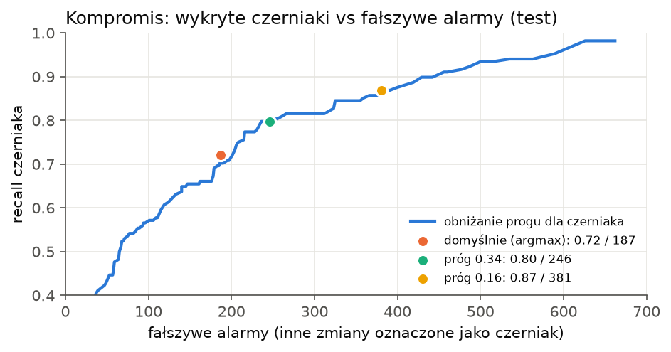
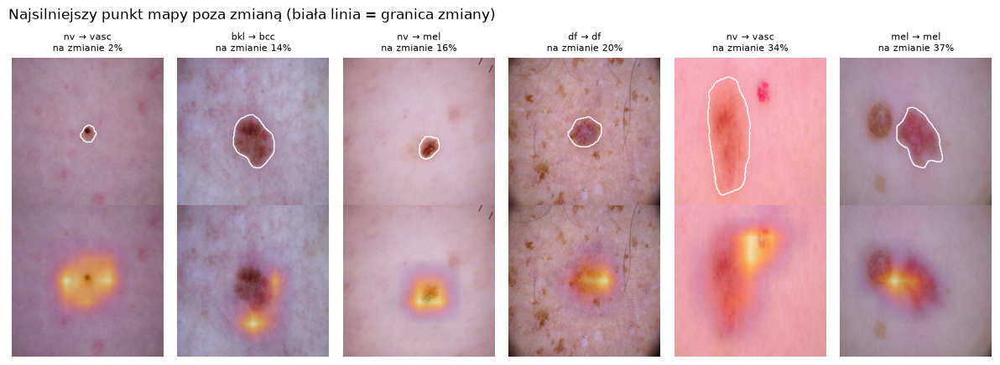
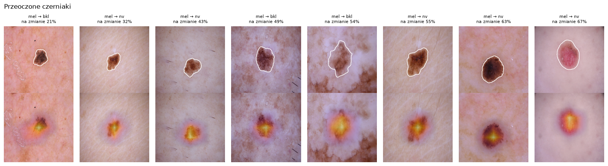

# Klasyfikacja zmian skórnych z wykorzystaniem CNN, ze szczególnym uwzględnieniem wykrywania czerniaka

*Sprawozdanie – kamień milowy 3 · Michał Kowalik · listopad 2026*

## 1. Cel etapu

Celem etapu była ocena końcowa wybranego modelu na danych niewykorzystywanych podczas uczenia, analiza błędów, dodanie warstwy wyjaśnialności (Grad-CAM) wraz z weryfikacją hipotezy H5 oraz przygotowanie aplikacji wykorzystującej model.

Oceniany model: **E5_s0** – EfficientNet-B0 + RandAugment + ważona CE, 30 epok (wybór uzasadniony w kamieniu 2). Zbiór testowy (1503 zdjęcia, 15% zmian, podział po `lesion_id`) został użyty jednokrotnie. Kod: `kamien3.ipynb`, aplikacja: `app.py`.

## 2. Ocena końcowa

| Metryka | Walidacja | Test | 95% CI (test) |
|---|---|---|---|
| balanced accuracy | 0,798 | **0,815** | 0,785 – 0,842 |
| recall czerniaka | 0,759 | **0,720** | 0,654 – 0,789 |
| macro-F1 | 0,711 | 0,732 | |
| AUC (makro) | 0,967 | 0,961 | |
| AUC czerniaka | 0,899 | 0,888 | |

Przedziały ufności wyznaczono metodą bootstrap (1000 losowań zdjęć ze zwracaniem). Wynik na teście jest zgodny z walidacją: balanced accuracy jest nawet nieco wyższe, a recall czerniaka niższy o ok. 4 punkty procentowe – czego należało się spodziewać, bo ziarno wybrano według recallu czerniaka na walidacji. Różnice mieszczą się w przedziałach ufności, więc wynik walidacyjny nie był zawyżony.

| Klasa | nv | mel | bkl | bcc | akiec | vasc | df |
|---|---|---|---|---|---|---|---|
| liczba zdjęć | 1005 | 168 | 165 | 78 | 49 | 21 | 17 |
| recall | 0,78 | 0,72 | 0,68 | 0,82 | 0,76 | 0,95 | 1,00 |
| precyzja | 0,96 | 0,39 | 0,63 | 0,65 | 0,67 | 0,91 | 0,59 |

## 3. Analiza błędów

- **Fałszywe alarmy czerniaka.** Najczęstszy błąd to znamię (nv) rozpoznane jako czerniak – 157 zdjęć (16% znamion). Wynika to z ważonej straty, która karze przeoczenie rzadkiej klasy mocniej niż fałszywy alarm. Precyzja czerniaka wynosi 0,39, czyli na każdy wykryty czerniak przypada ok. 1,5 fałszywego alarmu.
- **Przeoczone czerniaki.** 47 z 168 czerniaków model zaklasyfikował inaczej – głównie jako nv (22) i bkl (15). Analiza Grad-CAM (sekcja 5) pokazuje, że w tych przypadkach model patrzy na samą zmianę, więc błędy wynikają z jej wyglądu (podobieństwo do znamienia lub zmiany łagodnej), a nie z artefaktów.
- **bkl ↔ mel.** 26 zmian łagodnych (bkl) uznano za czerniaka – to klasy trudne do odróżnienia także dla dermatologów.
- **Klasy rzadkie** (vasc, df) mają wysoki recall (0,95–1,00), ale są bardzo nieliczne (21 i 17 zdjęć), więc wynik jest mało precyzyjny.
- **Źródło zdjęć.** Trafność różni się między ośrodkami (63–97%), jednak balanced accuracy jest podobne (0,70–0,75). Wysoka trafność dla vidir_molemax wynika ze składu klas (prawie wyłącznie znamiona), a nie z przewagi modelu – nie widać, by model korzystał z cech konkretnego ośrodka.

## 4. Próg decyzyjny dla czerniaka

Domyślnie model wybiera klasę o najwyższym prawdopodobieństwie. Alternatywnie zmianę można uznać za czerniaka, gdy p(mel) ≥ t. Próg t dobrano na zbiorze walidacyjnym (dla zadanego recallu), a jego skutki sprawdzono na teście.

| Reguła | Recall mel | Precyzja mel | Fałszywe alarmy | Balanced acc. |
|---|---|---|---|---|
| domyślnie (argmax) | 0,720 | 0,393 | 187 | 0,815 |
| t = 0,34 | **0,798** | 0,353 | 246 | **0,816** |
| t = 0,28 | 0,815 | 0,322 | 288 | 0,811 |
| t = 0,16 | 0,869 | 0,277 | 381 | 0,782 |

Próg **t = 0,34** podnosi wykrywalność czerniaka z 72% do 80% bez spadku balanced accuracy, kosztem 59 dodatkowych fałszywych alarmów. Dalsze obniżanie progu daje coraz mniejszy zysk przy szybko rosnącej liczbie alarmów. Dla zastosowania przesiewowego, w którym przeoczony czerniak jest groźniejszy niż dodatkowa konsultacja, rekomendowany jest próg ok. 0,34.

## 5. Wyjaśnialność: Grad-CAM i weryfikacja H5

Grad-CAM wyznacza mapę fragmentów obrazu, które najbardziej wpłynęły na decyzję – na podstawie gradientów wyniku wybranej klasy względem ostatniej warstwy konwolucyjnej. Aby ocenić mapy ilościowo, wykorzystano publiczne maski segmentacji zmian dla HAM10000 (Tschandl i in., Harvard Dataverse) i dla każdego zdjęcia testowego policzono:

- **udział mapy na zmianie** – jaka część mapy Grad-CAM leży wewnątrz maski (dla mapy rozłożonej równomiernie byłaby to powierzchnia zmiany),
- **położenie maksimum** – czy najsilniejszy punkt mapy leży na zmianie. Ta miara jest potrzebna, bo mapa ma rozdzielczość 7 × 7 i przy małych zmianach „rozlewa się” poza maskę.

| Predykcje | Liczba | Mapa na zmianie | Maksimum na zmianie | Powierzchnia zmiany |
|---|---|---|---|---|
| poprawne | 1150 | 79% | 99,8% | 28% |
| błędne | 353 | 73% | 98,9% | 26% |
| wszystkie | 1503 | 78% | 99,6% | 27% |

**H5 – nie potwierdzona.** Model w zdecydowanej większości przypadków patrzy na samą zmianę: 78% mapy przypada na obszar zajmujący średnio 27% kadru, a maksimum mapy leży poza zmianą tylko na 6 z 1503 zdjęć (4 z nich to błędne predykcje). W błędnych predykcjach mapa jest nieco mniej skupiona na zmianie (73% wobec 79%). Nieliczne przypadki „poza zmianą” to np. zaczerwieniona skóra wokół małego znamienia albo druga, czerwona zmiana obok tej opisanej w masce – w obu przypadkach model wskazał zmianę naczyniową.

Przy przeoczonych czerniakach mapa Grad-CAM skupia się na zmianie – model patrzy we właściwe miejsce, ale błędnie ocenia jej wygląd. Artefakty (linijki, włosy, ciemne ramki) nie są więc istotnym źródłem błędów tego modelu.

## 6. Aplikacja

Aplikacja `app.py` (Gradio) uruchamiana poleceniem `python app.py` działa w przeglądarce i nie wymaga GPU (poniżej 1 s na zdjęcie na procesorze). Użytkownik wgrywa zdjęcie dermatoskopowe i otrzymuje:

- trzy najbardziej prawdopodobne typy zmiany wraz z prawdopodobieństwami,
- mapę Grad-CAM nałożoną na zdjęcie, z możliwością wyboru klasy, dla której mapa ma zostać wyznaczona (np. „dlaczego nie czerniak?”),
- przykładowe zdjęcia ze zbioru walidacyjnego z podaną prawdziwą klasą,
- informację, że aplikacja nie jest narzędziem diagnostycznym.

Wspólny kod modelu, przetwarzania zdjęć i Grad-CAM znajduje się w `model.py`, używanym zarówno przez aplikację, jak i notebook kamienia 3. Zgodność przetwarzania sprawdzono: model wczytany przez `model.py` daje na zbiorze walidacyjnym dokładnie te same wyniki co podczas treningu.

## 7. Mocne i słabe strony

**Mocne strony:**

- rzetelna ocena: podział po `lesion_id` (bez wycieku), zbiór testowy użyty raz, przedziały ufności, 3 ziarna losowe na wariant,
- dobra separacja klas (AUC 0,96) i wysoki recall klas złośliwych bcc i akiec (0,82 i 0,76),
- ilościowo zweryfikowana wyjaśnialność – model opiera decyzje na zmianie, a nie na artefaktach,
- możliwość dostosowania czułości na czerniaka progiem decyzyjnym, bez ponownego treningu.

**Słabe strony i ograniczenia:**

- niska precyzja czerniaka (0,39) – dużo fałszywych alarmów, głównie wśród znamion,
- przy domyślnym progu ok. 1 na 4 czerniaki pozostaje niewykryty (28%),
- zbiór z dwóch ośrodków, głównie jasna karnacja; model uczony wyłącznie na zdjęciach dermatoskopowych – dla zwykłych zdjęć z telefonu wyniki mogą być błędne,
- zamknięty zbiór 7 klas – model zawsze wskaże jedną z nich, także dla zdjęć spoza dziedziny,
- mała liczba zdjęć klas rzadkich w zbiorze testowym (df: 17, vasc: 21) i duża zależność recallu czerniaka od ziarna losowego,
- niska rozdzielczość map Grad-CAM (7 × 7).

## 8. Podsumowanie projektu

| Hipoteza | Wynik |
|---|---|
| H1: transfer learning > CNN od zera | potwierdzona (+24 pkt proc. balanced accuracy) |
| H2: obsługa niezbalansowania zwiększa recall czerniaka | potwierdzona (0,55 → 0,67–0,70) |
| H3: augmentacja poprawia wyniki | częściowo (RandAugment najlepszy; brak augmentacji → przeuczenie) |
| H4: losowy podział zawyża wyniki | potwierdzona (+7,6 pkt proc. balanced accuracy) |
| H5: część błędów wynika z patrzenia poza zmianę | nie potwierdzona (maksimum mapy na zmianie w 99,6% zdjęć) |

Odpowiedź na pytanie badawcze: sieć konwolucyjna (EfficientNet-B0 z transfer learningiem) rozpoznaje typ zmiany skórnej na zdjęciu dermatoskopowym zmiany, której nie widziała podczas uczenia, z balanced accuracy 0,815, a czerniaka wykrywa w 72% przypadków – lub w 80% po dostosowaniu progu decyzyjnego, bez utraty ogólnej skuteczności. Analiza Grad-CAM pokazuje, że model opiera decyzje na samej zmianie. Główną słabością pozostaje duża liczba fałszywych alarmów, przez co model nadaje się co najwyżej jako narzędzie wspomagające wstępną selekcję, a nie samodzielną diagnozę.
